# Varlık bağımlılık grafiği (tüm admin domain)

Amaç: Bir isteği planlarken "önce ne var olmalı?" sorusunu cevaplamak. Ön koşul kayıt yoksa liste ekranında **ara**
(salt okunur), yoksa plana ekle ve bu sırayla oluştur.
"UI zorunlu" = admin ekranı bu kayıt olmadan formu göstermiyor / validasyon geçmiyor.

## 1. Kurulum sırası (yeni tenant için önerilen)

1. **Para birimi** (`/settings/currencies`) — store view'ın para birimi buradan seçilir.
2. **Mağaza görünümü / store view** (`/settings/store-views`) — en az 1 (varsayılan). Kategoriler ve ürünler için UI zorunlu.
3. **Vergi sınıfları** (`/settings/tax-classes`) + **vergi ayarları** (`/settings/taxes`) — fiyat girişinin yorumunu belirler.
4. **Depo** (`/inventory/warehouses`) — stok için (en az 1, varsayılan silinemez). Yeni depo, ilk depo olsa bile otomatik varsayılan olmaz: "Varsayılan Depo" işaretli **ve Aktif** olmalı ([../../playbooks/warehouse-setup.md](../../playbooks/warehouse-setup.md)).
5. **Özellikler** (`/attributes`) → **Özellik setleri** (`/attributes/sets`) — ürün için set UI zorunlu.
6. **Kategoriler** (`/categories`) — ürün için en az 1 UI zorunlu.
7. **Markalar** (`/brands`) — opsiyonel; ürün formunda marka alanı henüz yok (geliştiriliyor); ürün listesinde marka filtresi var.
8. **Müşteri grupları** (`/customers/groups`) — kademeli/grup fiyatı kullanılacaksa.
9. **Medya** (`/content/media`) — banner, logo, blog görselleri için.
10. **Ürünler** (`/products/new`) → **stok** (`/inventory/stock`).
11. **Ödeme sağlayıcı** (`/settings/payments`), **kargo taşıyıcı** (`/settings/shipping/carriers`) — sipariş için. Fatura için ayrıca şirket VKN'si (`/settings/general`) ve fatura modu / e-Fatura sağlayıcısı (`/settings/einvoice`).
12. **Roller → admin kullanıcıları** (`/system-users`) — ekip üyesi davet edilecekse (davet rol ister).
13. İçerik/tasarım: sayfalar, ana sayfa blokları, navigasyon menüsü, header/footer, marka kimliği.
14. Pazarlama: promosyon → kupon; segment (+ e-posta şablonu) → kampanya; e-posta şablonu → otomasyon; Meta bağlantısı
    (+ pixel) → Meta kitlesi / huni / deney / uyarı.
15. Pazar yeri: bağlantı (`/settings/marketplace`) → kategori eşleme → (Trendyol) marka eşleme → ürün gönderimi.

Not: Onboarding sihirbazı (kurulumu tamamlanmamış mağazada açılan pencere) bu sıranın bir kısmını (store view, ek store view'lar, para birimi,
marka kimliği, kategoriler, vergi sınıfı tohumlama) tek seferde yapabilir.

## 2. Mermaid

```mermaid
graph TD
  CUR[Para birimi<br/>/settings/currencies] --> SV[Store view<br/>/settings/store-views]
  SV --> CAT[Kategori<br/>/categories]
  SV --> PROD[Ürün<br/>/products/new]
  SV -. çeviri .-> BRAND[Marka<br/>/brands]
  SV -. çeviri .-> ATTR
  SV -. çeviri / politika sayfası .-> PAGE[İçerik sayfası<br/>/content/pages]
  CUR --> PROD
  ATTR[Özellik<br/>/attributes] --> ASET[Özellik seti<br/>/attributes/sets]
  ASET --> PROD
  ASET -. opsiyonel .-> CAT
  CAT --> PROD
  BRAND -. ürün formunda henüz yok .-> PROD
  WH -. stok>0 ise 422 .-> PROD
  TAX[Vergi sınıfı<br/>/settings/tax-classes] -. opsiyonel, varsayılana düşer .-> PROD
  TAXS[Vergi ayarları<br/>/settings/taxes] -. fiyat yorumu .-> PROD
  CG[Müşteri grubu<br/>/customers/groups] -. kademeli fiyat .-> PROD
  LBL[Ürün etiketi] -. opsiyonel .-> PROD
  ATTR -- configurable --> VAR[Varyant]
  PROD --> VAR
  WH[Depo<br/>/inventory/warehouses] --> STK[Stok<br/>/inventory/stock]
  PROD --> STK
  SUP[Tedarikçi<br/>/inventory/suppliers] --> PO[Satın alma siparişi<br/>/inventory/purchase-orders]
  WH --> PO
  PO -- teslim alma --> STK
  WH --> TRF[Transfer<br/>/inventory/transfers]
  TRF --> STK
  WH --> CC[Sayım<br/>/inventory/cycle-counts]
  CC --> STK
  STK -. yeniden sipariş noktası .-> RPT[Yeniden sipariş raporu] -.-> PO
  CUST[Müşteri<br/>/customers] -. veya misafir .-> ORD[Sipariş<br/>/orders/new]
  PROD --> ORD
  STK --> ORD
  PAY[Ödeme sağlayıcı<br/>/settings/payments] --> ORD
  SHIP[Kargo taşıyıcı<br/>/settings/shipping/carriers] -- teslimat tipi kargo ise --> ORD
  CUR --> ORD
  ORD --> INV[Fatura / e-Fatura]
  ORD --> CM[İade / alacak dekontu]
  ORD -. rezervasyon, iade ile stoğa dönüş .-> STK
  SUBP[Abonelik ürünü] --> SUB[Abonelik<br/>/subscriptions] -- her yenileme --> ORD
  CUST --> CRM[CRM kişi / fırsat / görev<br/>/customers/crm]
  ROLE[Rol<br/>/system-users/roles] --> AU[Admin kullanıcısı<br/>/system-users]
  PROMO[Promosyon<br/>/marketing/promotions] --> CPN[Kupon<br/>/marketing/coupons]
  GEN -. mağaza saat dilimi .-> PROMO
  CPN -- kullanım, iptal/tam iadede geri --> ORD
  SHIP -. kodsuz ücretsiz kargo kuralı .-> ORD
  CUST --> SEG[Segment<br/>/customers/segments]
  SEG --> CMP[Kampanya<br/>/marketing/campaigns]
  TPL[E-posta şablonu<br/>kapsam dışı] --> CMP
  TPL --> WF[Otomasyon<br/>/marketing/workflows]
  MAIL --> CMP
  RULES -. sıklık limiti / sessiz saat .-> WF
  CUST -. tetikleyici olaylar .-> WF
  METAC[Meta bağlantısı + reklam hesabı<br/>/marketing/meta/settings] --> AUD[Meta kitlesi<br/>/marketing/meta-ads/audiences]
  METAC --> FUN[Meta hunisi<br/>/marketing/meta-ads/funnels]
  METAC --> EXP[Meta deneyi<br/>/marketing/meta-ads/experiments]
  METAC -. uyarı kuralı hariç .-> ALR[Meta uyarısı<br/>/marketing/meta-ads/alerts]
  SEG -. özel kitle, kişisel veri Meta'ya .-> AUD
  AUD -. benzer kitle .-> AUD
  FUN --> EXP
  PIX[Meta Pixel / CAPI<br/>/marketing/meta-ads/pixel] -. vitrin olayları .-> FUN
  PROD -. Değerlendirmeler işareti .-> REV[Değerlendirme<br/>/marketing/reviews]
  GEN -. Değerlendirmeler sekmesi, ilk durum .-> REV
  PROD -. URL kısayolu değişince elle .-> RED[Yönlendirme<br/>/seo/redirects]
  CAT -. slug değişince elle .-> RED
  MEDIA[Medya<br/>/content/media] -. görsel .-> HOME[Ana sayfa blokları<br/>/design/homepage]
  MEDIA -. görsel .-> BLOG[Blog]
  MEDIA -. logo .-> BRANDING[Marka kimliği<br/>/branding]
  MEDIA -. görsel .-> CAT
  MEDIA -. logo .-> BRAND
  CAT --> NAV[Navigasyon menüsü<br/>/design/navigation]
  PAGE --> NAV
  BLOG --> NAV
  PROD --> NAV
  CAT -. blok seçici .-> HOME
  PROD -. blok seçici .-> HOME
  SG[Beden rehberi<br/>/content/size-guides] -. ürün türüne göre vitrin penceresi .-> PROD
  GEN[Genel ayarlar<br/>/settings/general] -. spam koruması .-> FORM[Form<br/>/content/forms]
  FORM -. Form bloğu .-> PAGE
  FORM -. Form bloğu .-> BLOG
  FORM --> SUB[Form gönderimleri]
  GEN -. VKN / firma bilgisi .-> EINV[e-Fatura sağlayıcı<br/>/settings/einvoice]
  EINV --> INV
  MAIL[E-posta gönderimi<br/>/settings/notifications] --> NTF[Bildirim şablonları]
  ORD -. olaylar .-> NTF
  RULES[Gönderim kuralları<br/>/settings/notifications/frequency] -. pazarlama sınırı .-> NTF
  WH -. gönderici adresi .-> SHIP
  PROD -. ağırlık / ölçü .-> SHIP
  PROD -. olaylar .-> WEBH[Web kancası<br/>/settings/webhooks]
  ORD -. olaylar .-> WEBH
  MPS[Pazaryeri bağlantısı<br/>/settings/marketplace] --> MPC[Kategori eşleme<br/>/marketplace/:channel/categories]
  MPC --> MPP[Ürün gönderimi<br/>/marketplace/:channel/products]
  PROD --> MPP
  STK -. kullanılabilir − tampon, birkaç sn .-> MPS
  MPS -. pazaryeri siparişi .-> ORD
  ORD -. gelir, iptal/tam iade düşer .-> ANL[Panel / Analitik / Raporlar<br/>/, /analytics, /reports]
  CM -. iade metrikleri .-> ANL
  PROD -. Birim Maliyet → brüt kâr .-> ANL
  GEN -. çerezsiz ziyaretçi sayımı .-> ANL
  SIDX[Arama dizini<br/>/settings/search-index] --> SRCH[Header araması<br/>/search]
```

Ayar ekranlarının tamamı ve etkileri: [settings-overview.md](../screens/settings/settings-overview.md).

## 3. Varlık tablosu

| Varlık | Bağımlı olduğu (önce var olmalı) | Oluşturulduğu ekran | Kullanan | Silme kısıtları |
|---|---|---|---|---|
| Para birimi (currency) | — | `/settings/currencies` (dialog `Para Birimi Ekle`/`Add Currency`) | Store view (`currency`), ürün fiyatları/FX, sipariş, ödeme sağlayıcı para birimi | Bir store view kullanıyorsa silinemez: `ERR_CURRENCY_IN_USE` 409 "Currency X is used by store views: …" |
| Store view | Para birimi (UI'da seçilir), plan özelliği `multi_language` (2. görünüm için, `ERR_FEATURE_REQUIRED`) | `/settings/store-views` (Sheet/dialog `Mağaza Görünümü Ekle`); detay `/settings/store-views/[code]` | Kategori/ürün/marka/özellik çevirileri, sayfa çevirileri, çerez politikası sayfası, storefront routing | Varsayılan silinemez: "Cannot delete default store view". Dil (locale) sonradan değiştirilemez (`ERR_STORE_VIEW_LOCALE_IMMUTABLE`); aynı dilde ikinci aktif görünüm olamaz (`ERR_STORE_VIEW_LOCALE_EXISTS`) |
| Vergi sınıfı | — | `/settings/tax-classes` | Ürün vergi sınıfı (ops.; boşsa mağaza varsayılanı) | Varsayılan sınıf silinemez: `TAX_CLASS_DEFAULT_UNDELETABLE` 409 |
| Vergi ayarları (tenant) | — | `/settings/taxes` | Tüm fiyat girişleri: `Product prices I enter include tax`, `Show customers prices with tax included`, sepet grup fiyatı | Silinmez (ayar) |
| Özellik (attribute) | Store view (çeviri için ops.) | `/attributes/new` | Özellik seti; configurable ürün varyant ekseni (özelliğin uygulandığı ürün tipleri) | Bir sette varsa: `ATTRIBUTE_IN_USE_BY_ATTRIBUTE_SETS` 409; ürünlerde değer varsa: `ATTRIBUTE_IN_USE_BY_PRODUCTS` 409 |
| Özellik seti | Özellikler | `/attributes/sets/new` | Ürün (özellik seti **zorunlu**); kategori (ops., `ERR_CATEGORY_ATTRIBUTE_SET_INVALID`) | Varsayılan silinemez (409); ürün kullanıyorsa `ERR_ATTRIBUTE_SET_IN_USE` 409 |
| Kategori | ≥1 store view (UI ön koşulu); üst kategori (ağaç) | `/categories/new` | Ürün (≥1 kategori **zorunlu**), navigasyon menüsü, ana sayfa blokları, beden kılavuzu, pazaryeri eşleme, filtreler | Alt kategorisi varsa `ERR_CATEGORY_HAS_CHILDREN`; ürünü varsa `ERR_CATEGORY_HAS_PRODUCTS` (400). Slug benzersiz `ERR_CATEGORY_SLUG_EXISTS` |
| Marka | — (çeviriler için store view) | `/brands/new` | Ürün (ürün formunda marka alanı henüz yok (geliştiriliyor)), ürün listesi filtresi | Ürünü varsa silinemez: "Cannot delete brand '…' because it has N associated products" 409; slug benzersiz 409 |
| Müşteri grubu | — | `/customers/groups` (dialog) | Ürün kademeli fiyat seçicisi (yalnız aktif gruplar); sepette uygulanması `/settings/taxes` "Sepette kademe fiyatlarını uygula" anahtarına bağlı | Silme grubun müşteri ilişkilerini kaldırır; kademe fiyatına etkisi doğrulanmadı ([customer-groups.md](../screens/customers/customer-groups.md)) |
| Ürün etiketi (label/badge) | — | Ürün formu `Ürün Etiketleri` sekmesi; görsel stiller `/branding` "product badges" sekmesi (doğrulanmadı) | Ürün | doğrulanmadı |
| **Ürün** | UI ön koşulları (hepsi ≥1): store view, kategori, özellik seti, aktif para birimi; form zorunluları: kategori, özellik seti, temel fiyat; ops.: vergi sınıfı (boşsa tenant varsayılanı), müşteri grubu, etiket. **Başlangıç stoğu > 0 girilirse varsayılan depo şart**: yoksa 422 `WAREHOUSE_NOT_CONFIGURED` "No default warehouse configured for this tenant…". Marka alanı ürün formunda henüz yok (geliştiriliyor) | `/products/new` (tip seçimi), `/products/new-by-code` | Stok, sipariş, ana sayfa/navigasyon seçiciler, pazaryeri, CRM fırsat ürünleri | Silme = arşivleme (soft, `products:delete`); kalıcı silme yalnız arşivden ve SKU yazarak (`products:delete:permanent`). SKU benzersiz (`product.sku.duplicate`). Abonelik ürünü plan ister (`ERR_PRODUCT_SUBSCRIPTION_PLAN_REQUIRED`). Configurable ana ürün stoğu düzenlenemez (`product.stock.not_editable_for_configurable`) |
| Varyant | Configurable ürün + varyant ekseni özellikleri | Ürün formu `Varyantlar` | Stok, sipariş | Ürünle |
| Depo | — (adres için konum verisi) | `/inventory/warehouses/new` | Stok, satın alma, transfer, sayım, kargo gönderici adresi (Geliver; depo adresi ile kargo hesabındaki gönderici adresi ayrı kayıtlardır), kargo fiyat tahmininde çıkış deposu (aktif depolardan öncelik numarası en düşük olan), sipariş dağıtımı | Son depo silinemez (`WAREHOUSE_CANNOT_DELETE_LAST`); varsayılan silinemez; silme `inventory:admin` ([warehouses.md](../screens/inventory/warehouses.md)) |
| Stok | Ürün (SKU) + depo | `/inventory/stock`, `/inventory/stock/[sku]`, ürün formu `Stok Yönetimi` | Sipariş (ödeme adımında süreli rezervasyon, karşılanınca "Satış" hareketi; iptal/süre dolunca serbest), "stok gelince haber ver" müşteri e-postası (0'dan yukarı çıkınca), düşük/tükenen stok yönetici uyarısı, web kancası `inventory.*` olayları | Stok kaydı arşivlenebilir; stoklu varyant silinince stok kaydı arşivlenir ([stock.md](../entities/stock.md)) |
| Tedarikçi | — | `/inventory/suppliers/new` | Satın alma siparişi (yalnız **Aktif** tedarikçi seçilebilir; yeni tedarikçi "Onay Bekliyor" başlar; PO para birimi tedarikçiden gelir) | "Sil" pasife alır ([suppliers.md](../screens/inventory/suppliers.md)) |
| Satın alma siparişi | Aktif tedarikçi + aktif depo + katalogdaki SKU'lar | `/inventory/purchase-orders/new` | Onayda depodaki "Gelen" artar; teslim almada hedef depoya stok girişi; tedarikçi performansı | Yalnız Taslak silinir; Kısmi Teslim'den sonra iptal yok. Tedarikçiye e-posta gitmez ([purchase-orders.md](../screens/inventory/purchase-orders.md)) |
| Transfer | İki depo + kaynakta yeterli kullanılabilir stok | `/inventory/transfers` | Gönderimde kaynakta rezerve; tamamlamada hedefe giriş, kaynaktan kesin düşüm; stok hareketleri | Gönderimden sonra iptal yok; onay `inventory:admin` ([transfers.md](../screens/inventory/transfers.md)) |
| Sayım | Depo + SKU stok kaydı | `/inventory/cycle-counts` | Tolerans içindeki farklar gönderimde, kalanlar onayla stoğa yazılır; sayılan miktar rezervenin altına inemez (`INSUFFICIENT_STOCK`) | ([cycle-counts.md](../screens/inventory/cycle-counts.md)) |
| Müşteri | — (adres için konum; en çok 5 adres, ülke Türkiye) | `/customers/new` | Sipariş, segment, grup, CRM (kişi/fırsat/görev/etkileşim müşteri ID'sine bağlanır), wishlist. Oluşturma hoş geldin e-postasını tetikleyebilir; şifre daveti ayrı buton ("Hesabı Aktive Et", mağaza URL'si gerekir) | GDPR silme/anonimleştirme geri alınamaz ([customer-detail.md](../screens/customers/customer-detail.md)) |
| CRM kişisi / fırsatı / görevi / etkileşimi | Var olan müşteri kaydı (kişi ve etkileşim için zorunlu; görevde ops.); plan özelliği `crm` | `/customers/crm/*` | Fırsat ürün satırları yalnız atıftır (kataloğa yazmaz, stok ayırmaz); kazanılan fırsat sipariş oluşturmaz; etkileşim kaydı e-posta/SMS göndermez | Kişi, fırsat, görev silme kalıcı; etkileşim ekrandan silinmez ([deals.md](../screens/customers/crm/deals.md)) |
| Ödeme sağlayıcı | Para birimi (sağlayıcıda seçilir) | `/settings/payments` → `/settings/payments/[id]` | Vitrin ödeme adımı, admin sipariş oluşturma, taksit, iade, ödeme raporu | Varsayılan sağlayıcı kaldırılamaz; önce başka biri varsayılan yapılır ([payments.md](../screens/settings/payments.md)) |
| Kargo taşıyıcı | Geliver hesabı (kullanıcının kimlik bilgisi); depo (gönderici adresi); ürün ağırlık/ölçüsü veya varsayılan koli | `/settings/shipping/carriers` | Checkout kargo seçenekleri ve fiyatları (seçenek yoksa sipariş tamamlanamaz), kapıda ödeme, admin sipariş oranı, otomatik kargo | Varsayılan taşıyıcı ve fiyat kuralları ekranda yönetilir ([shipping-carriers.md](../screens/settings/shipping-carriers.md)) |
| **Sipariş (admin'den)** | Sırayla: aktif para birimi → aktif ödeme sağlayıcı → aktif kargo entegrasyonu (mağazadan teslimde gerekmez) → yayında ve stoklu ürün → müşteri (ops.; yoksa misafir) ; adres (ülke/il/ilçe) | `/orders/new` | Stok rezervasyonu (iptal/silmede serbest, alacak dekontu iadesinde stoğa dönüş), fatura, iade/RMA, alacak dekontu, kargo etiketi (kargo entegrasyonu + depo gönderici adresi + tahsil edilmiş ödeme), kupon kullanımı (iptal/tam iadede geri verilir), müşteriye sipariş e-postaları | İptal/iade geri alınamaz; ayrı onay ([order-detail.md](../screens/orders/order-detail.md)) |
| Fatura / e-Fatura | Sipariş; şirket VKN'si (`/settings/general`) → fatura modu ve e-Fatura sağlayıcı (`/settings/einvoice`) → siparişin fatura adresi ve alıcının VKN/TCKN'si | Sipariş detayı, `/invoices` | Platform modunda gönderim GİB'e gider | ([invoices.md](../screens/orders/invoices.md)) |
| Abonelik | `subscription` tipi ürün (plan ister) | Vitrinden; admin `/subscriptions` izler ve iptal eder | Her yenileme kaynağı "Abonelik" olan bir sipariş oluşturur | ([subscriptions.md](../screens/orders/subscriptions.md)) |
| Promosyon | — (mağaza saat dilimi tarih alanlarını yorumlar). Türler: yüzde / tutar / ücretsiz kargo; en az sepet tutarı, tarih penceresi, toplam ve müşteri başı sınır; admin ekranında ürün/kategori/segment kapsamı seçilmez | `/marketing/promotions/new` | Kupon (kupon olmadan müşteriye etkisi yok — admin'den oluşan promosyon kuponludur), sipariş indirimi (kupon + otomatik indirim toplamı ara toplamın %80'iyle sınırlı; ücretsiz kargo ayrı kargo indirimi). Kodsuz "X TL üzeri ücretsiz kargo" promosyon değil kargo kuralıdır (`/settings/shipping/carriers`) | Silme geri alınamaz; bağlı kuponlar çalışmaz → alternatif "Duraklat" (tüm kodları durdurur) ([promotions.md](../screens/marketing/promotions.md)) |
| Kupon | **Promosyon** (zorunlu; indirimin tamamı promosyondan). Kodun çalışması için promosyon **Yayında** ve promosyon + kupon tarihleri geçerli olmalı; müşteri başı sınır promosyonda, promosyonun tüm kuponları için ortak | `/marketing/coupons/new`, toplu `/marketing/coupons/bulk` (en çok 10.000; üretilen kodlar **Aktif** başlar) | Sepet/checkout (sepette en fazla 3 kod), sipariş (kullanım sipariş iptali ve tam iadede geri verilir, kısmi iadede verilmez) | Kullanılmış (geri verilmemiş) kupon silinemez `ERR_COUPON_HAS_REDEMPTIONS`; kod sonradan değişmez ([coupons.md](../screens/marketing/coupons.md)) |
| Segment | Müşteriler (kural tabanlı) | `/customers/segments/new` | Kampanya hedeflemesi (yalnız pazarlama izni olan üyelere gider), Meta özel kitlesi ([audiences.md](../screens/marketing/meta/audiences.md)); segmente kısıtlı promosyon admin ekranından kurulmaz | Oluşunca Pasif ve 0 üyeli; "Yeniden Oluştur" gerekir, üyelik son oluşturma anındaki halidir. Silme geri alınamaz, arşivleme geri alınır ([segments.md](../screens/customers/segments.md)) |
| Kampanya (e-posta) | **Tek** segment (Aktif + yeniden oluşturulmuş) ya da "Tüm müşteriler"; ≥1 e-posta şablonu (şablon yönetimi kapsam dışı); e-posta gönderimi ayarlı (`/settings/notifications`) | `/marketing/campaigns/new` | Müşteriye e-posta; alıcılar **gönderim anında** belirlenir (segmentin son oluşturulmuş üyelerinden pazarlama izni olan + e-postası doğrulanmış olanlar) | Silme yalnız Taslak, İptal, Tamamlandı durumunda; Gönderiliyor/Tamamlandı'da buton yok ([campaigns.md](../screens/marketing/campaigns.md)) |
| Otomasyon (iş akışı) | Gönder adımındaki ada birebir eşleşen **aktif** e-posta şablonu; tetikleyici olay (sepet terki, kayıt, sipariş, alışverişsizlik, stok/fiyat, doğum günü); gönderim kuralları (sıklık limiti + sessiz saatler) | `/marketing/workflows` (boş ya da şablondan; menüde yok) | Tetikleyiciyi yaşayan her müşteriye e-posta (Aktifken sürekli) | Ekranda silme/kopyalama/arşivleme yok; Aktif akış düzenlenmez → önce Duraklat ([workflows.md](../screens/marketing/workflows.md)) |
| Değerlendirme (review) | Ürün + müşteri (vitrinden gelir); ürünün "Değerlendirmeler" işareti; Genel Ayarlar → Değerlendirmeler sekmesi (satın alma zorunlu, doğrulanmışları otomatik onay → ilk durum) | — (moderasyon `/marketing/reviews`) | Vitrin ürün puanı (yalnız onaylılar) | Panelde silme, düzenleme, toplu moderasyon yok ([reviews.md](../screens/marketing/reviews.md)) |
| Medya | — | `/content/media` (yükleme), form içi medya seçici | Ana sayfa blokları, blog, sayfa, beden rehberi, kategori/marka görseli, SEO görseli, logo (branding/header/footer), mega menü — hepsi URL ile | Kullanım yeri gösterilmez; silme kalıcıdır, kullanan görseller kırılır ([media.md](../entities/media.md)). Özel font: `ERR_FONT_IN_USE` |
| İçerik sayfası | Store view (çeviri; çerez politikası sayfası store view'a bağlanır) | `/content/pages/new` | Navigasyon menüsü, footer linkleri | doğrulanmadı |
| Blog yazısı | Medya (ops.); store view dilleri (çeviri) | `/content/blog/new` | Navigasyon/footer linkleri, vitrin `/blog`, yorumlar | Silme kalıcı, yorumlarıyla birlikte; menü linkleri güncellenmez ([blog-post.md](../entities/blog-post.md)) |
| Beden rehberi | — (ürünle bağ "Ürün Türü" alanıyla; ürün formunda alan yok) | `/content/size-guides/new` | Vitrin ürün sayfasındaki "Beden Rehberi" penceresi (aynı türde yayında+aktif, en küçük Sıralama) | Silme kalıcı ([size-guides.md](../screens/content/size-guides.md)) |
| Form (iletişim vb.) | Spam koruması açıksa Genel › Güvenlik kimlik bilgisi; yönlendirme hedefi sayfa/ürün/kategori (ops.) | `/content/forms/new` | Sayfa/blog Form blokları (yayındaki form, adresiyle), bülten aboneliği (şablona göre) | Kalıcı silinmez, arşivlenir (adres serbest kalır, bloklar boşalır); gönderimler e-postaya göre silinir ([form.md](../entities/form.md)) |
| Yönlendirme (redirect) | — (ön koşul kayıt yok; hedef adresin vitrinde açıldığını önceden kontrol et) | `/seo/redirects/new`, CSV içe aktar | Vitrin; ürün/kategori slug'ı değişince **otomatik oluşmaz** → ayrı adım olarak planla | Silme kalıcı; dışa aktarma yok; döngü/zincir `ERR_REDIRECT_LOOP` ([redirects.md](../screens/seo/redirects.md)) |
| Navigasyon menüsü | Kategori / sayfa / blog / ürün (link seçiciler, `/design/navigation`) | `/design/navigation` | Storefront header (boşsa dashboard'da `Mağazanızın üst menüsü boş` uyarısı) | — |
| Ana sayfa | Medya, kategori, ürün (blok seçiciler) | `/design/homepage` (blok editörü) | Storefront | Yayınla/taslak |
| Header / Footer | Medya (logo), sayfalar (linkler) | `/layout-settings?tab=header|footer` | Storefront | — |
| Marka kimliği (branding) | Medya/font | `/branding`, `/branding/ai-wizard` | Storefront teması | Font kullanımda silinemez |
| Pazaryeri ürün gönderimi | Bağlantı **Bağlı** (`/settings/marketplace`) → kategori eşleme (+ zorunlu kanal özellikleri ürünün aynı adlı niteliğinden) → (Trendyol) marka eşleme → gönderim. Ürün: barkod ≤40, birincil kategori + eşleme, fiyat > 0, liste fiyatı ≥ satış fiyatı | `/marketplace/[channel]/products` | Pazaryeri ilanı; stok değişince bağlı aktif kanallara kullanılabilir − tampon birkaç sn içinde gider; pazaryeri siparişleri LeanCart'a gelir. Komisyon önceliği ürün > kategori > varsayılan; LeanCart içi hesaptır, pazaryerine gönderilmez | Yeni ilan pazaryerinde geri alınamaz şekilde oluşur; kaldırma satıcı panelinden ([channel-products.md](../screens/marketplace/channel-products.md)) |
| Meta bağlantısı / Pixel | Kullanıcının Meta Business hesabı (OAuth) + reklam hesabı seçimi; pixel için Pixel ID (kimlik bilgileri gizli, kullanıcı girer) | `/marketing/meta/settings`, `/marketing/meta-ads/pixel` | Kitle, huni, deney ("Bağlı" mod ister); uyarı kuralı oluşturma bağlantı istemez. Pixel → vitrin olayları → huni metrikleri. Reklam hesabı para birimi → huni bütçesi | Bağlantıyı kesmek Meta'daki kampanyaları durdurmaz ([meta-settings.md](../screens/marketing/meta/meta-settings.md)) |
| Meta kitlesi / huni / deney / uyarı | Segment → özel kitle (müşteri kişisel verisi Meta'ya gider; segment değişince kitle kendiliğinden güncellenmez); özel kitle → benzer kitle; huni → deney | `/marketing/meta-ads/{audiences,funnels,experiments,alerts}/new` | Meta reklam hesabı; huni "Yayınla" / "Devam ettir" harcama başlatır | Kitle silme Meta'dan da siler; deney "Durdur" geri alınamaz ([meta-overview.md](../screens/marketing/meta/meta-overview.md)) |
| Rapor şablonu / analitik | Sipariş (gelir; iptal ve tam iade gelirden düşer), alacak dekontu (iade metrikleri), ürün "Birim Maliyet" (brüt kâr), çerezsiz ziyaretçi sayımı ayarı ("Onay vermeyen ziyaretçiler" kartı) | `/analytics/reports/templates/new` | Zamanlanmış rapor alıcılara **e-posta** gönderir (dış adres olabilir) | Şablon silme geri alınamaz, zamanlamayı da bitirir ([reports.md](../screens/analytics/reports.md)) |
| Admin kullanıcısı / rol | Davet için en az bir rol | `/system-users`, `/system-users/roles` | Yetkiler; tüm işlemler denetim günlüğüne düşer | Hassas; rol işlemleri yalnız super_admin; panelde kullanıcı silme ve rol değiştirme kontrolü yok ([system-users.md](../screens/system/system-users.md)) |
| API anahtarı / web kancası | — | `/settings/api-keys`, `/settings/webhooks` | Dış entegrasyonlar; web kancası sipariş/ürün/envanter/müşteri olaylarını iletir | Gizli değerler bir kez gösterilir — Claude okumaz/aktarmaz |
| Bildirim şablonu | E-posta gönderimi kurulumu; mağaza adresi (test için) | `/settings/notifications` (hazır şablonlar düzenlenir) | Sipariş, kargo, stok olaylarının e-posta/SMS'i; pazarlama mesajları gönderim kurallarına tabi | Şablon silinmez, kapatılır |
| Pazaryeri bağlantısı | Kullanıcının satıcı hesabı kimlik bilgisi | `/settings/marketplace` → `/settings/marketplace/[id]` | Kategori eşleme, ürün gönderimi, pazaryeri sipariş/stok/fiyat ([marketplace-channel.md](../entities/marketplace-channel.md)) | — |

## 4. Formları etkileyen tenant geneli ayarlar

| Ayar | Nerede | Etkisi |
|---|---|---|
| Varsayılan store view + çevrilebilir store view'lar | `/settings/store-views` | Formlardaki store view çubuğu/dil seçicide hangi seçeneklerin çıktığı; çeviri tamamlanma rozetleri; varsayılan görünümün dili "varsayılan kapsam" etiketi |
| Para birimleri (aktif) + baz kur | `/settings/currencies` | Fiyat alanının para birimi, çok-para-birimli fiyat önizlemesi, sipariş para birimi; ürün ön koşulu |
| Vergi: fiyatlar KDV dahil mi / müşteriye KDV dahil göster | `/settings/taxes` | Ürün fiyatına yazılan değerin net mi brüt mü yorumlanacağı; önizleme metni `You enter X → customer sees Y` |
| Varsayılan vergi sınıfı | `/settings/tax-classes` | Ürün vergi sınıfı boşsa uygulanan oran |
| Mağaza saat dilimi ("shop clock") | Genel ayarlar › bölgesel biçim ve saat dilimi | Kampanya/kupon/promosyon/zamanlanmış güncelleme `datetime-local` alanları mağaza saatine göre yorumlanır |
| Plan / özellikler (`plan`, `features`) | `/settings/general` → Plan ve Abonelik | Plana bağlı ekranlar (AI sihirbazı), ikinci store view (`multi_language`) |
| Kargo yapılandırması / Geliver gönderici adresleri | `/settings/shipping/carriers`, depo formu | Sipariş oran tahmini, depo formundaki gönderici adresi alanı |
| Ödeme sağlayıcı varsayılanı | `/settings/payments` | Sipariş oluşturmada ödeme yöntemi listesi |
| Yorum ayarları, captcha, form spam koruması | `/settings/general` | Formlar/yorumlar; Değerlendirmeler sekmesi yeni ürün değerlendirmesinin ilk durumunu belirler |
| Çerezsiz ziyaretçi sayımı | `/settings/general` → Analitik (anında kaydeder) | Panel/Analitik "Onay vermeyen ziyaretçiler" kartı |
| Arama dizini | `/settings/search-index` | Header araması (`/search`) sonuçları |
| Storefront URL'si | `/settings/general` / alan adları | "Mağazayı Görüntüle"/önizleme butonları (adres yoksa devre dışı) |

## 5. Plan çıkarırken kontrol listesi

- Ürün oluşturmadan önce: store view ≥1, aktif para birimi ≥1, kategori ≥1 (hedef kategori!), özellik seti ≥1
  (configurable ise varyant eksenleri sette ve bu ürün tipine uygulanabilir olmalı) — eksikse form yerine `Ürün Eklemeden Önce Kurulumu Tamamlayın` kartı çıkar.
  Stok girilecekse varsayılan depo olmalı (yoksa 422). Vergi sınıfı adla aranmalı (opsiyonel). Marka alanı formda henüz yok (geliştiriliyor).
- Stok girmeden önce: depo var mı, hangisi varsayılan ve aktif? Yoksa önce [warehouse-setup](../../playbooks/warehouse-setup.md).
- Admin'den sipariş için: aktif ödeme sağlayıcı ve (kargo ise) kargo entegrasyonu var mı, ürün stoklu mu?
- Satın alma siparişi için: tedarikçi **Aktif** mi?
- Segmenti hedeflemede kullanmadan önce: "Yeniden Oluştur" yapıldı mı, üye sayısı > 0 mı?
- Kupon için: hangi promosyona bağlanacak? Yoksa önce promosyon. Promosyon Yayında ve tarihleri geçerli mi?
- Kampanya için: segment Aktif ve yeniden oluşturulmuş mu, e-posta şablonu var mı? Otomasyon için: Gönder adımındaki
  şablon adı aktif bir şablonla birebir eşleşiyor mu?
- Ürün/kategori URL'si değişecekse: eski adres için yönlendirme ayrı adım olarak plana eklendi mi?
- Pazaryerine gönderim için: kanal Bağlı mı, birincil kategori eşli mi, barkod ve fiyatlar kurala uygun mu?
- Stok işlemlerinde: bağlı pazaryeri varsa özetin yan etkisine "bağlı pazaryerlerinde stok da güncellenir" yaz.
- Meta işlemleri için: mod "Bağlı" mı? Huni yayınlama harcama başlatır; kitle oluşturma kişisel veriyi Meta'ya gönderir.
- Banner/görsel için: kullanıcı dosya yolu verdi mi, yoksa medya kütüphanesinde mevcut mu?
- Navigasyona link için: hedef kategori/sayfa var ve yayında mı?
- Silme isteklerinde yukarıdaki kısıtları önceden kontrol et (ör. kategori boş mu, marka ürünsüz mü) ve kullanıcıya söyle.
